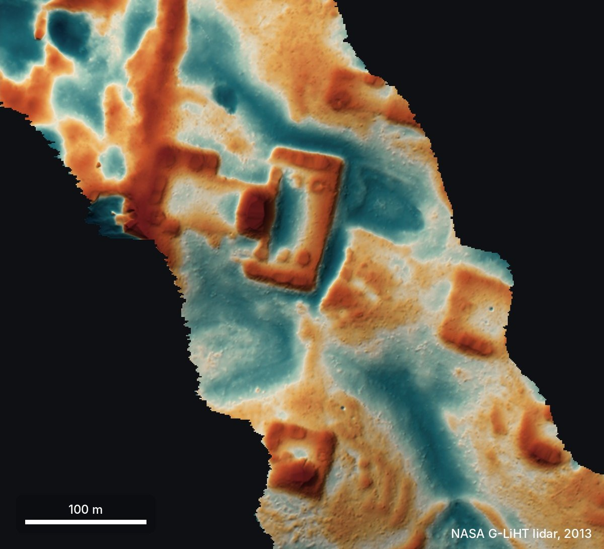
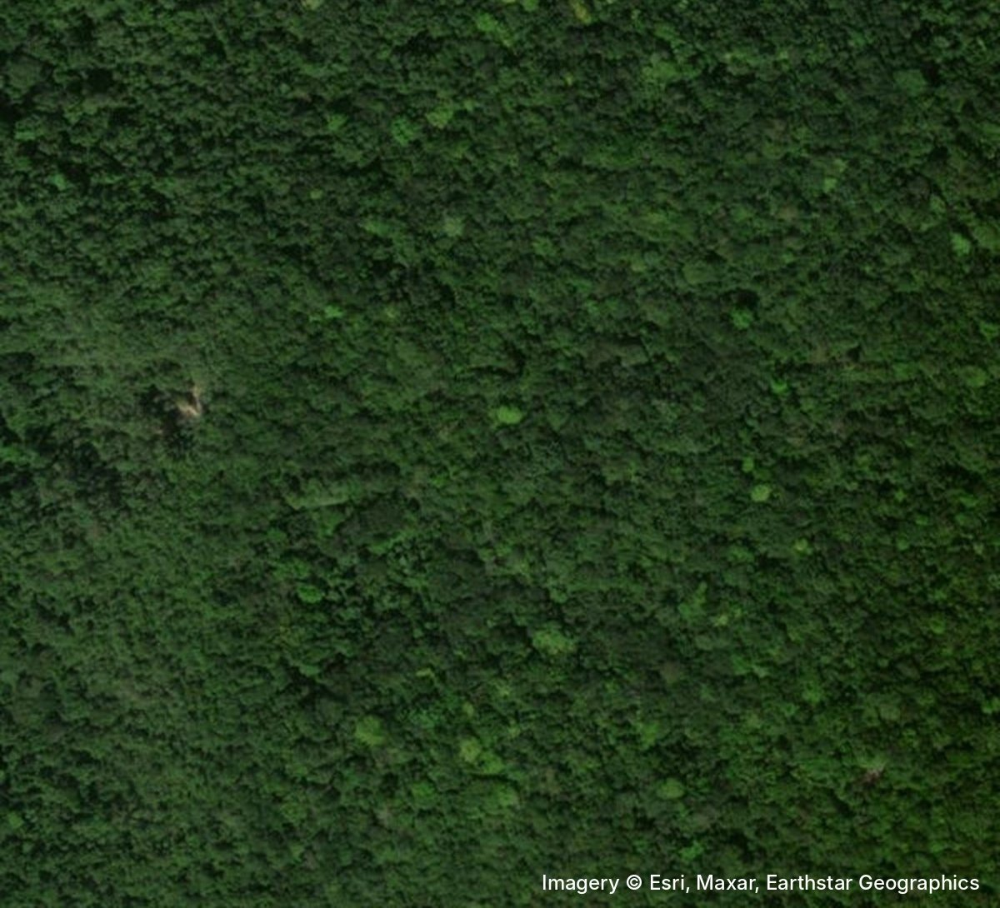
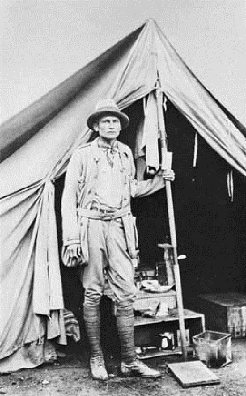
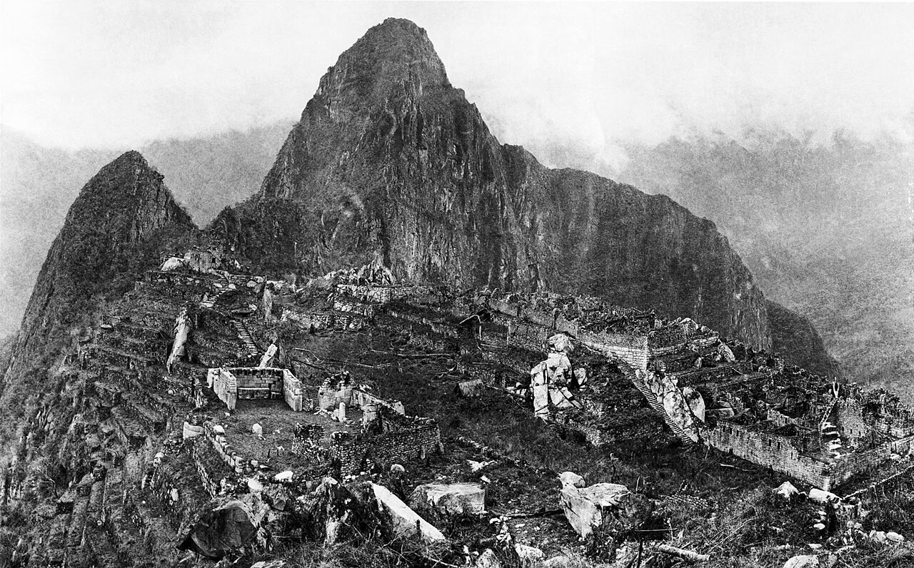
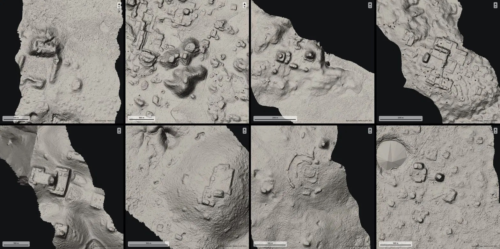
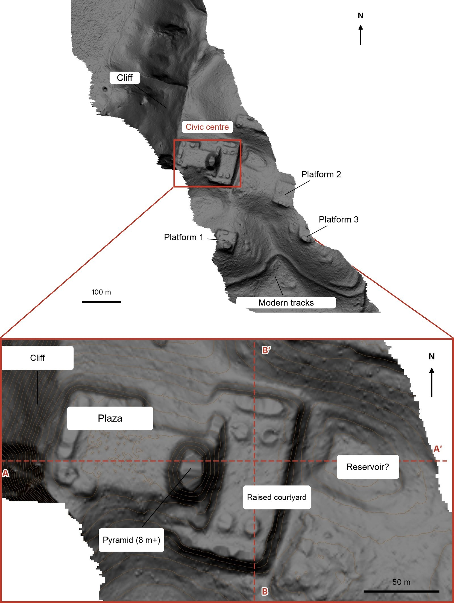
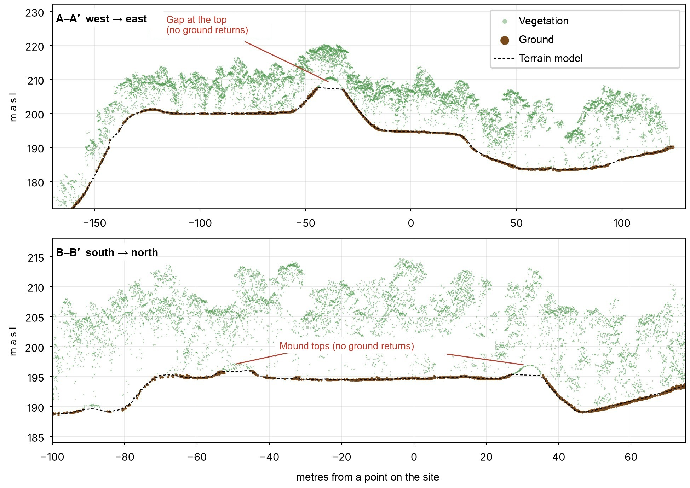
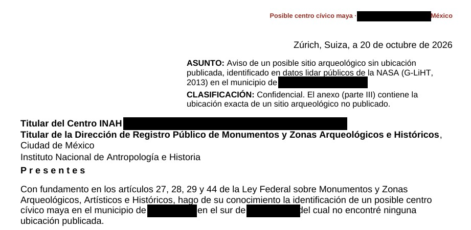
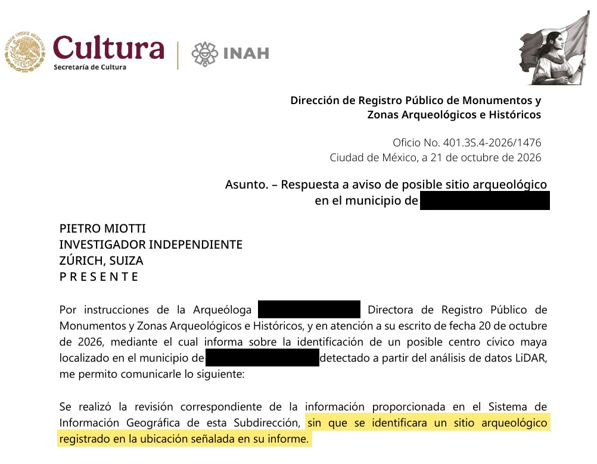
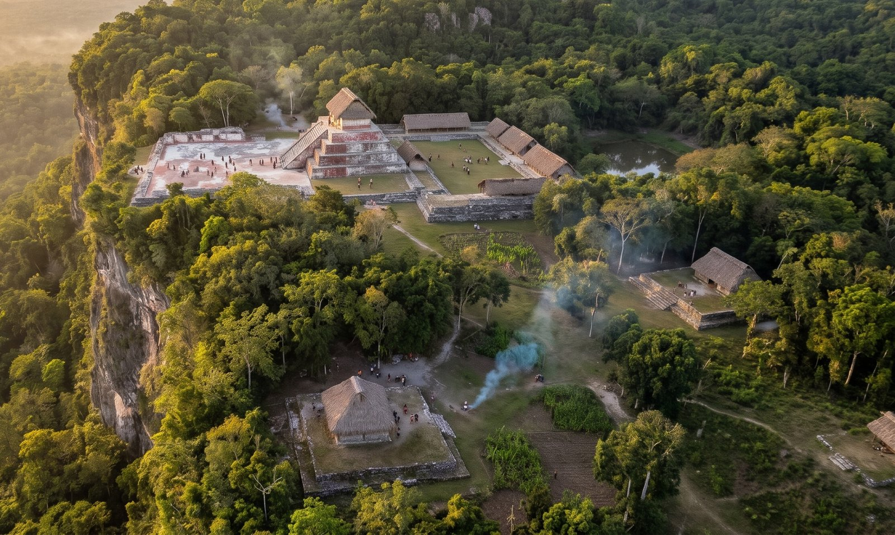

+++
title = "My AI Agents Found an Unmapped Maya Site"
description = "AI agents analyzed NASA lidar data overnight and found a Maya site under the jungle that isn't on any map. Less than 72 hours later, Mexico's INAH replied."
date = 2026-11-10
draft = false

[extra]
image = "forest-vs-lidar.jpg"
read_time = 5
+++

By analyzing NASA lidar data, my AI agents discovered a Maya site in Mexico that, as far as anyone can tell, no one had reported before. It took **less than 72 hours** to go from a random thought while traveling to an official reply from the Mexican government. This is by far the best time ever to be alive.

<figure>
  

    
    Lidar: bare ground, 2013
    

      
      Satellite image today
    

    

    <input type="range" min="0" max="100" value="50" step="0.1" aria-label="Drag to compare the satellite image and the lidar">
  

  <figcaption><strong>Drag the slider.</strong> The same hilltop today from a satellite (just trees) and in lidar (no trees). Colours show height. Satellite © Esri, Maxar, Earthstar Geographics.</figcaption>
</figure>

*Disclaimer: I'm not an archaeologist.*

I'm going to tell this story as a diary, because the timeline is probably the best part.

## 18 October

I was traveling in Peru, Gemini-ing about the history of the place, when I learned about [Hiram Bingham](https://en.wikipedia.org/wiki/Hiram_Bingham_III), the American explorer who "discovered" [Machu Picchu](https://en.wikipedia.org/wiki/Machu_Picchu) in 1911. "What luck!" I thought. He was actually looking for a different city, [Vilcabamba](https://en.wikipedia.org/wiki/Vilcabamba,_Peru), the last refuge of the Incas, when a local farmer in the valley below guided him to the ruins. "Imagine if Bingham had our tools," I thought. "What would he do?"

<figure>
  

    
    
  

  <figcaption><strong>Left:</strong> Bingham at his tent, 1912. <strong>Right:</strong> Machu Picchu, photographed by Bingham the same year. Public domain, Wikimedia Commons (<a href="https://commons.wikimedia.org/wiki/File:Hiram_Bingham_at_Machu_Picchu,_1912.jpg">left</a>, <a href="https://commons.wikimedia.org/wiki/File:Machupicchu_hb10.jpg">right</a>).</figcaption>
</figure>

I brainstormed a bit with a few agents (Gemini, ChatGPT, Claude and Grok), and they all said [lidar](https://en.wikipedia.org/wiki/Lidar). From above, a ruin in the jungle is just a bunch of trees (like Machu Picchu before it was cleared), so satellite photos don't help much. Lidar, instead, fires laser pulses through the gaps in the canopy and maps the ground underneath.[^lidar]

So the agents went looking for lidar data. Peru isn't well covered, and hiring a company to do a survey meant permits, costs and bureaucracy, so I gave up on that. Then I thought: why not the [Maya](https://en.wikipedia.org/wiki/Maya_civilization)? Their region is much better covered by public lidar.

That night, I asked the agents to analyze it and went to bed.

## 19 October

I woke up and checked the agents' reports. 'DAMN!' They had found lots of villages and other regular shapes that looked like structures or houses.

<figure>
  
  <figcaption>A few of the sites the agents flagged overnight. Keep an eye on the bottom-left one.</figcaption>
</figure>

**So how did they do it?** They turned the lidar strips (about 1,200 km² of jungle) into images, and 48 agents went through them one by one like very patient archaeologists, looking for pyramids, platforms, and plazas while filtering out natural hills, sinkholes, and roads. There was no special model or classifier involved: the agents literally looked at the pictures, following a precise guide.

> **Me:** That's awesome! Please check which of these villages haven't been discovered yet. Search both the literature and the archives.
>
> *…a few hours later…*
>
> **Agent:** One major village doesn't seem to have been registered.

This is the hilltop from the top of this post. It sits on the edge of a cliff, under the jungle, and it has straight edges and sharp corners. Nature doesn't really do straight lines.

Zooming in, there's a levelled plaza, an oval pyramid at least 8–12 m tall, a raised courtyard attached to it and a flat-bottomed hollow that might have been a water reservoir.

<figure>
  
  <figcaption>The hilltop with the trees removed (top), and a zoom into its civic centre (bottom).</figcaption>
</figure>

And this is what it looks like in 3D.

<figure>
  <video class="autoplay-in-view" src="M2_lidar_360.mp4" poster="m2-360-poster.jpg" muted loop playsinline controls preload="metadata" aria-label="3D lidar model of the site rotating 360 degrees: plaza, pyramid and courtyard on a hilltop"></video>
  <figcaption>The site in 3D, from the lidar. Heights exaggerated ~1.5×.</figcaption>
</figure>

> **Me:** OK, what should I do?
>
> **Agent:** You should contact [INAH](https://www.inah.gob.mx/) (Mexico's National Institute of Anthropology and History), write a report on your discovery, and check whether the site is in their register. Sometimes they have unpublished results.
>
> **Me:** OK, how do I contact INAH? How does the reporting process work?
>
> **Agent:** *…instructions for the report… + email addresses*
>
> **Me:** OK, please do the report.

And I went to bed.

## 20 October

I iterated on the report a bit, since a few things were off, and translated it into Spanish to improve the chances of getting a reply (at least, that's what Claude suggested). I don't speak Spanish, so I had to trust the agents on that one.

The agents also checked the raw point cloud, to make sure the shapes were really on the ground and not created by the trees. Green dots are leaves, brown dots are the ground.

<figure>
  
  <figcaption>Two slices through the raw lidar points. Under 10–17 m of forest, the ground (brown) traces the plaza, the pyramid and the courtyard.</figcaption>
</figure>

Then I sent the report to INAH.

<figure>
  
  <figcaption>The top of my letter to INAH. The exact coordinates went in a confidential annex, not shown here.</figcaption>
</figure>

## 21 October

INAH replied: they checked their records and found **no registered archaeological site at that location**.

<figure>
  
  <figcaption>INAH's reply. The highlighted part: <em>"…no registered archaeological site was identified at the location given in your report."</em></figcaption>
</figure>

To be clear, it's not official yet. But as far as anyone can tell, nobody had put this one on a map before.

## So what was it?

This part is speculation, from a long chat with the agents. It looks like a small Maya civic centre from the Classic period (roughly AD 250–900), basically the "downtown" of a local elite. The plaza is where people gathered, for ceremonies and maybe even a market. The pyramid was probably a temple, and the raised courtyard next to it might have been where the local ruler lived. The hollow could have been an *aguada*, a rainwater reservoir: Maya towns needed them to get through the dry season. Or it's just a hole. The three platforms around were probably houses.

I asked Gemini to imagine how it looked back then:

<figure>
  
  <figcaption>How it might have looked around AD 700. Generated with Gemini from the lidar layout</figcaption>
</figure>

For similar studies, have a look at how NASA's G-LiHT instrument works ([Cook et al. 2013](https://doi.org/10.3390/rs5084045)) and how lidar collected for environmental research can be reused for archaeology ([Golden et al. 2016](https://doi.org/10.1016/j.jasrep.2016.07.029)). In 2024, archaeologists found a whole Maya city in Mexico this way ([Auld-Thomas et al. 2024](https://doi.org/10.15184/aqy.2024.148)), others used lidar to estimate how many people lived in the Maya lowlands ([Estrada-Belli et al. 2025](https://doi.org/10.1016/j.jasrep.2025.105288)), and another study found what may have been ancient Maya marketplaces ([Šprajc 2026](https://doi.org/10.1017/S0956536126100923)).

## What's next

In the report I offered to help with a field check led by INAH. In Mexico, archaeological sites are protected by federal law, and any fieldwork needs INAH's authorisation, so it's now up to the local INAH centre to decide whether to send a team. If they go, I'll post an update.

## What I've learned

You can just do things. I'm not an archaeologist, so I didn't know this was supposed to be hard. I just picked an old problem, tried the most obvious thing and threw some compute at it. Being a naive outsider might be a superpower now.

And I don't think this is really about archaeology. So far, most agentic AI stories have been about coding, math and physics, but it's much more general than that, and I hope this small example makes it a bit more obvious. We are on the brink of a revolution in all the sciences, and the only bottlenecks left will be curiosity and imagination (and compute).

<strong>At this point, we should probably lidar the whole planet and let the agents discover the rest.</strong>

[^lidar]: If you don't know how lidar works, copy and paste this prompt into your favorite AI tool: "Build an HTML page that explains how lidar works, with beautiful visualizations."
